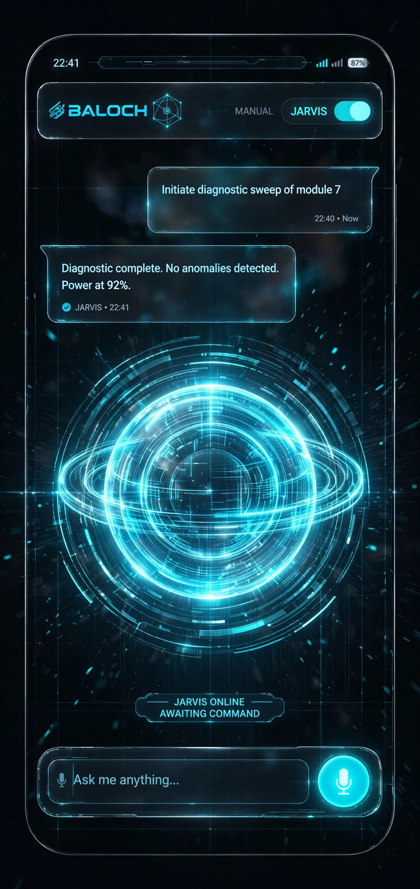
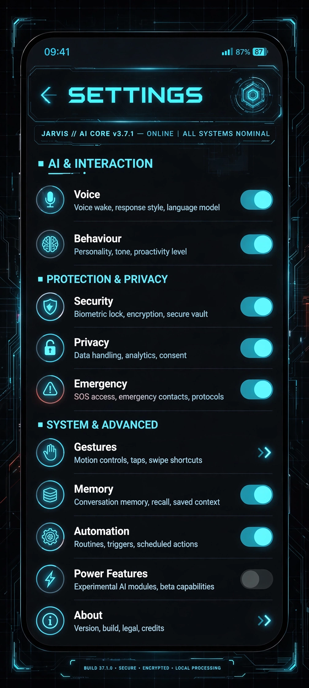
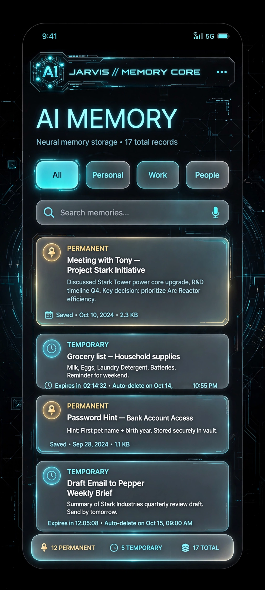

# ◈ BALOCH

**Your personal JARVIS for your whole Android device.** A holographic, voice-first AI assistant that lives on your phone — 100% on-device, trilingual, and always at your service, sir.

> Visual identity: **Holographic Cyan — Iron Man style.** Gunmetal mechanical ring, glowing cyan energy core, animated holographic orb.

---

## 🎨 Visual identity

Built around the official **Arc Reactor** logo — a glowing cyan **B** at the heart of a mechanical energy core, Iron Man style.

<p align="center">
  
</p>

| Splash | Main | Settings | Memory |
|---|---|---|---|
|  |  |  |  |

> *Honesty note: these are the official design mock-ups that define Baloch's look — concept visuals, not screenshots of the compiled app.*

---

## ✨ Highlights

**🎙️ Voice, your way**
- Trilingual speech in/out: English, اردو and हिन्दी — including Roman Urdu
- **Auto language detection**: speak in any language, Baloch replies in the same one — mid-conversation switching, no settings to touch
- One locked male voice per language, deep pitch, full volume by default
- Always-on “Hey Baloch” wake word — works with the screen off
- Whisper mode: catches soft speech and whispers back

**🧠 On-device AI brain**
- Hybrid intelligence: instant rule-based fast path + on-device LLM (Gemma via MediaPipe) for natural understanding
- The AI model downloads once on first run (~1.35 GB) — never bundled, never in the cloud
- Multi-agent engine: one command fans out to specialist agents running in parallel

**⚙️ Total device command**
- Open apps, alarms, timers, reminders, scheduling (one-time, daily, weekly)
- Wi-Fi, Bluetooth, torch, volume, brightness, Do Not Disturb, battery guardian
- Calls, SMS and WhatsApp draft intents; clipboard history; notes
- Pro pack: smart morning briefing, app-usage insights, routines/macros, calculator + currency converter, emergency ICE calling, fuzzy app search
- Life features: prayer times + Qibla, expense tracker, focus mode, location reminders, instant translation, SOS with location, driving mode

**🔒 Private by design**
- Everything runs on your phone. No accounts, no analytics, no ads, no cloud.
- Encrypted on-device memory (facts, conversations, people) with PIN-protected controls
- Voice lock: obeys only your voice (voiceprint + PIN fallback + biometric app lock)
- Privacy audit log shows every access to personal data

**🎭 Two modes**
- **MANUAL** — fully passive; acts only when asked
- **JARVIS** — proactive: briefings, alerts, routines, check-ins

---

## 🛠️ Tech stack

| Layer | Technology |
|---|---|
| Language / UI | Kotlin, Jetpack Compose (Material 3) |
| AI inference | MediaPipe Tasks GenAI (Gemma, on-device) |
| Wake word / STT | Vosk (offline) |
| Gestures | MediaPipe Tasks Vision (hand tracking) |
| Memory | Room + SQLCipher + Android Keystore |
| Scheduling | AlarmManager + WorkManager |
| Translation | ML Kit (on-device) |
| Min / Target SDK | 26 / 34 |

---

## 📋 Requirements

- Android 8.0 (API 26) or newer
- ~500 MB free storage (plus ~1.4 GB once for the optional AI brain model)
- Android Studio Ladybug or newer (to build from source)
- JDK 17

## 🔨 Build

```bash
# Android Studio: open this folder, then
./gradlew assembleDebug
# APK → app/build/outputs/apk/debug/app-debug.apk
```

Or grab the ready APK from the [Releases](../../releases) page — no build needed.

> CI: every push to `main` builds and publishes via GitHub Actions (`.github/workflows/build-apk.yml`).

## 🚀 First-run setup

1. Install the APK and open Baloch
2. Walk through the **feature tour** and grant permissions as asked ([permission map](PERMISSIONS.md)) — each is explained in plain language
3. **Voice-lock enrolment**: say “Hey Baloch, it is me” three times so Baloch recognises only you
4. Optional: **Settings → AI Brain** to download the on-device AI model (~1.35 GB, one time)
5. Optional: **Settings → Gestures** to calibrate camera and sensor gestures

## 📚 Docs

- [BUILD.md](BUILD.md) — detailed build & install guide
- [PERMISSIONS.md](PERMISSIONS.md) — every permission, why it is needed
- [PRIVACY.md](PRIVACY.md) — data handling & privacy architecture
- [CHANGELOG.md](CHANGELOG.md) — version history

## 🔐 Privacy promise

Baloch is **local-first**: your voice, memories, messages and personal data never leave your phone. There are no analytics SDKs, no crash reporters, no ads, and no accounts. Features that need the internet (web search, weather, live currency) say so plainly and degrade gracefully offline.

## 📄 Licence

Proprietary — © 2026 Kamran Khan / Magsi Digital. All rights reserved.
This source is made available for transparency and personal use with Baloch releases. Redistribution, modification or commercial use without written permission is prohibited. See [LICENCE](LICENSE).

---

*Built with the Baloch factory. Sir, at your service.* ◈
